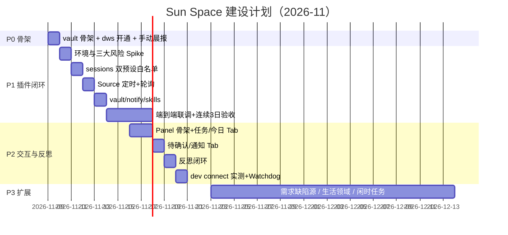

# Sun Space 实施工作计划

> 执行版计划，配合 [ARCHITECTURE.md](ARCHITECTURE.md)（v0.2）使用；§11 是里程碑视角，本文是任务视角。
> 制订日期：2026-11-07（周六）· 首个开工日建议：2026-11-09（周一）
> 投入假设：混合投入（工作日每天 2–3h + 周末可加码）；全职投入则压缩一半。

---

## 0. 里程碑总览

> **进度快照（2026-11-08 晚）**：P0 ✅ · P1 主体 ✅ · P2 部分 ✅（工作台 v9 + 直达子会话 + 拍板 + ask 卡全链路）· verify.mjs 自检 ✅（29 用例）。B 批清偿完成：sun_vault_meta 时区显示修复（schemas.md 契约同步）、ARCHITECTURE v0.4 对齐现实（§5.3 原生 schedule 定时 / §8.6 工作台定稿 / §4.1 轮换与 sun_route 薄包装）。下一阶段计划落档本文 §8。IM 入站延后（待机器人应用）。详见反思 2026-W45。

| 阶段 | 日期 | 主题 | 出口条件（DoD） |
|------|------|------|----------------|
| P0 | 11-09（1 天） | 骨架与开通 | 手动晨报产出合规 Journal + 任务笔记，Bases 看板可见 |
| P1 | 11-10 ～ 11-19（约 7 个投入日） | `sun-space` 插件闭环 | 连续 3 个工作日无人值守完成"晨报→确认→执行→落库→日报"，Router 全程未亲自执行 |
| P2 | 11-16 ～ 11-20（与 P1 验收期并行推进） | Panel + 确认卡 + 反思 | 一次日报意见切实改变次日行为；Panel 一屏看清当日全局 |
| P3 | 11-23 起（持续） | 扩展 | backlog 驱动 |

> P1 的"连续 3 日验收"是滚动观察（11-17 起），期间并行做 P2 开发，互不阻塞。

---

## 1. P0 · 骨架与开通（1 天）

| ID | 任务 | 产出 | 预估 |
|----|------|------|------|
| P0-1 | **立即发起 dws 企业管理员授权**（开发者平台「CLI 访问管理」） | 授权流水号；行政流程可能数天，故最先发起 | 15min（等待期不计） |
| P0-2 | 安装 dws + `dws auth login` + 验证读命令 | `dws todo task list` / `dws oa task list` / `dws calendar event list` 三条 json 输出各一份（存 `90-Meta/` 供开发期 mock） | 30min |
| P0-3 | 建 vault 骨架 | 附录 A 目录树 + `90-Meta/schemas.md` + `memory.md`/`runbook.md` 初始版 + `bases/任务看板.base` | 1h |
| P0-4 | 纯对话手动跑一次晨报 | 当日 `40-Journal/2026-11-09.md` 计划区 + 2–3 张 `proposed` 任务笔记（frontmatter 合规） | 1h |

**DoD**：Obsidian 打开 vault，任务看板 Base 能按 status 分组显示 P0-4 的笔记。

**降级预案**：若 P0-1 授权未下，P0-4 改用钉钉网页/客户端手动抄录 5 条待办作为 mock 数据——不阻塞后续任何开发。

---

## 2. P1 · `sun-space` 插件闭环（约 7 个投入日）

### D1（11-10）环境与三大风险 Spike —— 风险前置，最关键的一天

| ID | 任务 | 要回答的问题 | 产出 |
|----|------|-------------|------|
| P1-1 | clone [deepseek-harness](https://github.com/deepseek-ai/deepseek-harness)，跑通[官方插件教程](https://github.com/deepseek-ai/deepseek-harness/blob/master/docs/user/develop/basic/index.zh.md) | 本机 `dsh web --patch` 热载是否顺畅 | hello 插件截图/记录 |
| P1-2 | **Spike A：预设**。照原型 `cordis.patch.yml` 写空壳 `sun-router`/`sun-worker` preset，`sessionController.create` 建一个会话 | preset 定义与选择的实际机制？`tools.restrict` 在插件内可调吗 | 可运行 preset 骨架 |
| P1-3 | **Spike B：侧栏**。照原型 `src/client/` 抄最小 client 插件（侧栏入口 + 一个空面板） | client 注册 API 长什么样？与原型版本是否一致 | 空侧栏页截图（P2 的前置） |
| P1-4 | **Spike C：子会话**。用 Spike A 的 worker preset 真实创建一个子会话并跑通一条工具调用 | Worker 的创建/唤醒/结束在 DSH 的实际 API | `sessions.ts` 初版骨架 |

**DoD**：三个 Spike 各有一条"结论 + 代码骨架 + 与架构假设的差异记录"写进 `90-Meta/reflections/`。**任何一项与假设严重不符 → 当天回来改 ARCHITECTURE.md 对应节，再继续。**

### D2（11-11）sessions.ts：白名单与守卫

| ID | 任务 | 产出 |
|----|------|------|
| P1-5 | `ROUTER_TOOLS`（5 个 `sun_*`）+ `WORK_TOOLS`（对齐原型 19 项）+ `BLOCKED` 正则 | 白名单生效的会话各一个 |
| P1-6 | noWait 类守卫：`sleep` 拒绝、shell ≤30s、job 等待 ≤5s、Ticket 结束后工具失效 | 守卫单测（`pnpm vitest` 或最小断言脚本） |
| P1-7 | 5 个 `sun_*` 工具空壳（schema + 权限校验 + TODO 桩） | Router 会话里能列出并调用桩 |

### D3（11-12）sources/dws.ts：定时 + 轮询

| ID | 任务 | 产出 |
|----|------|------|
| P1-8 | `registerCron` 五个定时器（晨报/心跳/巡检/日报/周复盘） | 定时 Trigger 到达 Router |
| P1-9 | 轮询器：exec dws 三命令 → 快照 diff（对照 `50-Tasks` source_id）→ Trigger | 新待办出现 1 分钟内生成 Trigger（30min 周期） |
| P1-10 | 程序层过滤：`--jq` 字段裁剪、账号白名单、去重 | 干净 Trigger 队列（内存 + 落 `90-Meta/` 备查） |

### D4（11-13）vault / notify / skills

| ID | 任务 | 产出 |
|----|------|------|
| P1-11 | `vault.ts`：串行写入队列、Journal 独占、目录白名单（00/40/50/90）、frontmatter 校验 | 落库单测 |
| P1-12 | `notify.ts`：`dws chat` 推送 + 分级（info 攒批 / ask 立即）+ ≤100 字截断 | 钉钉真实收到三级消息各一条 |
| P1-13 | `prompts/router.md` + `skills/morning-brief`、`evening-report` 初版 | Router 按提示词走通晨报流程 |

### D5（11-16）端到端 + 连续验收（11-17 起 3 个工作日）

| ID | 任务 | 产出 |
|----|------|------|
| P1-14 | 全链路联调：晨报 Trigger → 计划落库 → 钉钉确认 → `sun_route` 派真实小任务（如"汇总某待办关联文档"）→ Worker 执行 → 结论落库 | 一次完整闭环的任务笔记 |
| P1-15 | 日报 Trigger → 草稿 → 钉钉审核 → `status: reviewed` | 当日 Journal 闭环 |
| P1-16 | **连续 3 个工作日无人值守**（每天只做确认与审核） | 3 天完整 Journal + 任务笔记集 = P1 验收物 |

---

## 3. P2 · 交互与反思（5 天，与 P1 验收期并行）

| ID | 日 | 任务 | 产出 |
|----|----|------|------|
| P2-1 | 11-16 | client 骨架：侧栏入口 + 路由 + 数据 provider（读 vault 索引） | 可导航空面板（基于 D1 Spike B 结论） |
| P2-2 | 11-17 | 任务 Tab（状态泳道，点开任务笔记）+ 今日 Tab（晨报/时间线/日报状态） | 两 Tab 可用 |
| P2-3 | 11-18 | 待确认 Tab（一键批准/驳回 → 写 `confirmations`）+ 通知 Tab（Journal 镜像） | Panel 完成确认闭环 |
| P2-4 | 11-19 | 反思闭环：evening-report 增强（读反馈意见 → runbook 修订建议 → 人审 diff 生效）；weekly-review | 一次真实的"意见→行为改变"记录 |
| P2-5 | 11-20 | `dws dev connect` 兼容性实测（不兼容则启用退路：纯通知 + 指令经桌面/轮询带入）；Watchdog 定时器上线；quiet by default 打磨 | IM 入口结论 + 巡检首跑 |

**DoD**：P2-4 的"意见→runbook diff→次日晨报行为变化"有完整留痕；Panel 五 Tab 全部可用。

---

## 4. P3 · 扩展 backlog（11-23 起，按需排期）

| 优先级 | 项 | 说明 |
|--------|----|------|
| 高 | 需求/缺陷数据源 | 先查公司工单是否有服务端 API → `dws api` raw；否则自建只读命令进 Source（架构 §6.5） |
| 中 | 生活领域分域 | finance（账单提醒）/ health / learning，复用 Source+Area 模式 |
| 中 | 闲时任务 | 归档（done>30d → 60-Archive）、双链补全、周报素材整理 |
| 低 | `dws event consume` 有界窗口实验 | 若轮询延迟确实痛（`--duration 10m` 窗口，仍无常驻进程） |
| 低 | bundle 发布本地 marketplace | 多机/备份用 |

---

## 5. 风险登记册（按杀伤力排序）

| # | 风险 | 影响 | 缓解 / 退路 | 触发点 |
|---|------|------|------------|--------|
| R1 | dws 管理员授权延迟或不通过 | P1 数据面全阻 | **P0-1 当天发起**；开发期用 P0-2 存的 json mock 驱动；极端情况走网页抄录降级 | 11-12 仍未授权 |
| R2 | DSH preset/`tools.restrict` 机制与原型有出入 | 白名单（架构核心）无法落地 | D1 Spike A 前置验证；退路：插件内运行时 restrict（原型 `sessions.ts` 即有此调用）+ 提示词约束降级 | D1 当天 |
| R3 | client 侧栏注册 API 与原型不符 | Panel 不可行 | D1 Spike B 前置；退路：Obsidian Bases 为主界面 + `panel.html` 静态导出 | D1 当天 |
| R4 | `dws dev connect` 不兼容 Harness | IM 直连不可用 | 已有等价退路（通知 + 轮询带入），功能无损、延迟=轮询间隔 | P2-5 |
| R5 | dws 凭证设备绑定（Keychain+MAC） | 换机/重装麻烦 | `dws auth export/import`；固定一台主力机 | 随时 |
| R6 | token 成本失控（Worker 滥用工具） | 费用 | 轮询零 LLM；Worker 并发上限（原型 WorkerSlots 同款：并发+1 预留人消息）；日报附当日 token 用量 | P1-16 起观察 |
| R7 | Journal/任务笔记并发写坏 | 数据损坏 | `vault.ts` 单写者队列；Worker 只写自己 artifacts（架构 §4.1/B1） | P1-11 单测 |

---

## 6. 前置阅读（开工前 1 小时）

1. [DSH 插件开发基础（中文）](https://github.com/deepseek-ai/deepseek-harness/blob/master/docs/user/develop/basic/index.zh.md) + [Cordis 教程](https://github.com/deepseek-ai/deepseek-harness/blob/master/docs/cordis-tutorial/index.zh.md)
2. 原型三个文件精读：`src/app/sessions.ts`（白名单/守卫）、`src/app/tools/main.ts`（14 工具）、`docs/005-panel.md`（Panel 规格）
3. dws：`dws schema "<path>" --compact` 自省机制 + `--dry-run`/`--jq` 约定（架构 §6.3）

---

## 7. 周一早上 checklist（2026-11-09）

- [ ] 发起 dws 管理员授权申请（P0-1，15 分钟，然后等）
- [ ] `curl` 安装 dws + `dws auth login`（P0-2）
- [ ] 三条读命令的 json 存入 `90-Meta/`（P0-2）
- [ ] 建 vault 骨架 + schemas + runbook/memory 初版（P0-3）
- [ ] 手动晨报一次，产出当日 Journal 与任务笔记（P0-4）
- [ ] clone deepseek-harness，明天 D1 从官方教程开跑（P1-1 预习）

---

## 8. 下一阶段执行计划（v2 · 2026-11-08 制定，2026-11-08 ~ 11-21）

> P2 收尾 + P3 启动。周一 11-09 生产首跑不在本计划内（首跑前唯一 quick win：把 SCHEDULE_TEMPLATES 的 ask 卡版 prompt 同步进两个生产 schedule）。每项收尾照旧 `pnpm verify` + 更新 HANDOFF。

### 第一批 · 巡检与自改进收尾（P2 清零，约 2 个投入日）——✅ 2026-11-08 完成

| ID | 任务 | 结果 |
|----|------|------|
| W-1 | **Watchdog 巡检上线** | ✅ 双层落地：①原生 schedule `schedule-104a7328`（`0 14,21 * * 1-5` Asia/Shanghai，target 生产会话）承载语义巡检——running >2h 卡死 / need-confirm >2h 积压重推 / Journal 缺环节补跑（仅工作日）；②TS 层（`source.ts`）承载机械职责——轮询连续失败 ≥2 次探活告警（1h 节流，trigger 落盘兜底）+ trigger TTL 7 天清理。测试 29→37。**双路径验收通过**：quiet 路径（周六造无异常场景 → 零通知零写入）+ urgent 路径（造 running/need-confirm 超时夹具各一 → 各发一条 urgent、DING 推送确认、一条消息一个决策点附 task_id、无误重派） |
| W-2 | **反思固化 + weekly-review 上线** | ✅ 周复盘 schedule `schedule-5b5d6ebd`（周五 17:00，target 生产会话）：任务/Journal 汇总 → `reflections/<周号>.md`（概览含派发预算执行、做得好/不好、runbook 修订建议 diff、下周关注含轮换触发线检视）→ Journal 周复盘小节 → ask 通知 → 人审后 diff 生效（路径同 runbook §7，W45 已实证）。首次真实运行：周五 11-14 17:00 |

### 第二批 · 小债清偿与文档对齐（半天）——✅ 2026-11-08 完成

| ID | 任务 | 结果 |
|----|------|------|
| B-1 | sun_vault_meta 时区显示 bug | ✅ 根因：带 `+08:00` 偏移的 datetime 被 Obsidian/Bases 换算显示差 8h（文件值正确）。修法：写入端改无后缀本地时间（`vault.ts` 新增 `localDate`/`localStamp`），顺带清除 `router-tools.ts` 两处 `toISOString()` 取"今天"的 UTC 隐患；vault 存量 24 处时间戳已迁移；schemas.md 契约同步（"日期一律本地时间无时区后缀"）；测试 27→29 |
| B-2 | ARCHITECTURE.md 对齐现实 | ✅ 升 v0.4：§5.3 定时清单改"DSH 原生 schedule 承载 + Source 只轮询"、§8.6 五 Tab → 工作台 v9 单页定稿、§4.1 补 sun_route 宿主薄包装与周期轮换、§0 图/§2.3/§8.8/§11/附录 B3/B4 同步 |
| B-3 | 计划落档 + 待办重排 | ✅ 本节 + HANDOFF §五 |

### 第三批 · P3 启动（11-13 起，按价值排序）

| ID | 任务 | 要点 | 验收 |
|----|------|------|------|
| P3-1 | 闲时任务 | 归档（done >30d → 60-Archive）、双链补全、周报素材整理；低频原生 schedule 近似"闲时"；skill 写清"只整理不决策" | 首次整理运行，产出可追溯 diff |
| P3-2 | 需求/缺陷数据源前置调研 | **待用户输入**：公司工单系统是哪家（钉钉项目/云效/Jira/自建）+ 有无 API 权限 → `dws api` raw 或自建只读命令；行政/权限等待是长尾，尽早发起 | 数据源结论 + 接入方案写入 ARCHITECTURE §6.5 |

### 挂起项（不排期，各有阻塞或属观察）

| 项 | 状态 |
|---|---|
| IM 三合一（dev connect 入站 + 真推送 + 卡片回调） | 等机器人应用建成，建成即做（约半天） |
| 生产 schedule prompt 同步 ask 卡版 | ✅ 已核实完成（11-07 上会话已更新） |
| 会话轮换触发线（catalog >50） | 观察，W46 周复盘检视 |
| TS 层 vault 机械巡检（逾期/Inbox 进轮询） | 先由 W-1 巡检清单覆盖，有真实痛点再做 |
| Make 式指令 / 语音甩待办 / Channel 分主题 | W45 已记录，P3 后期 |
| 生活领域分域（finance/health/learning） | backlog，巡检稳定运行一周后评估 |
| **复审 P2 backlog（第三轮复审遗留）** | ① 块式 YAML 经 sun_vault_meta 重写丢字段（解析器只认扁平+行内数组）② 沙箱 fail-open 默认 → fail-closed + workspaceRoot 钉死 ③ worker-guard 字面量可绕（正则加固）④ 看板 Journal 反链扩近 7 天 ⑤ client/server 两套 frontmatter 解析器合一 |
| 需求/缺陷数据源（P3-2） | **待用户输入**：公司工单系统是哪家（钉钉项目/云效/Jira/自建）→ 决定接入路线 |
